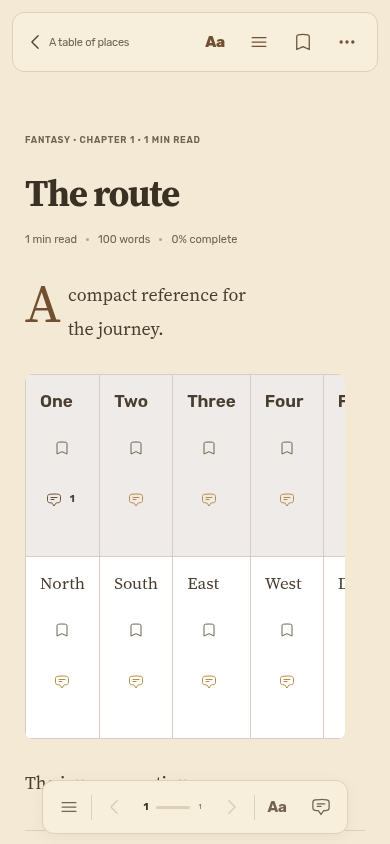
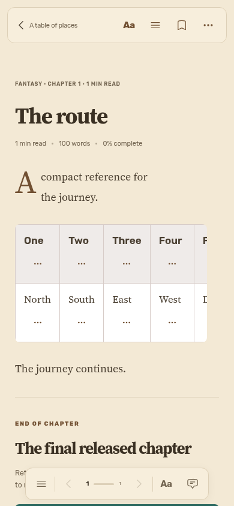
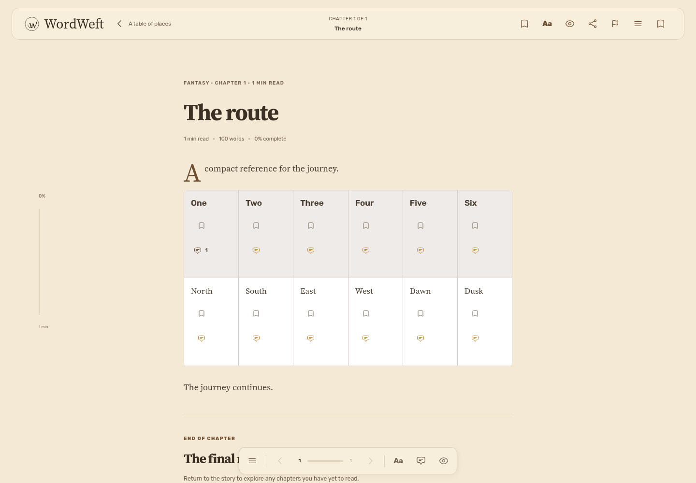
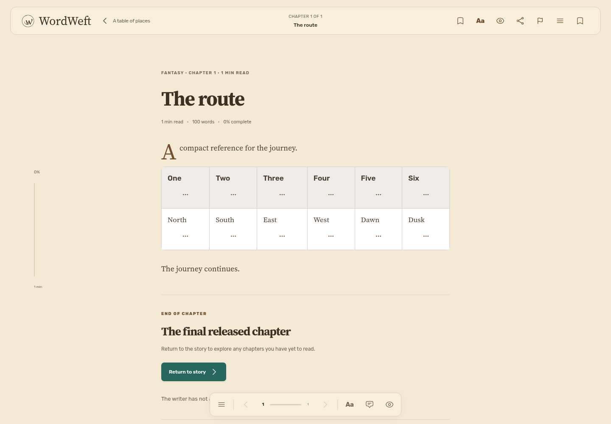

# #176 — compact table passage actions

Before, every table passage permanently reserved two 44px controls. After, a native disclosure exposes those same bookmark/comment controls on demand. One-word headers shrink from 181.8px to 97.8px at all four tested widths. The 44px disclosure is available to touch and keyboard without hover; opening it intentionally expands only that row. Passage anchors, bookmark indices and comment-thread identity remain unchanged.

| Viewport | Before | After |
| --- | --- | --- |
| Mobile, 390×844 |  |  |
| Desktop, 1440×1000 |  |  |

`after-actions-*.png` shows the disclosed controls. JSON files record matching header/table/document geometry. The table retains horizontal scrolling on narrow viewports and never widens the document.

Regression: `E2E_BASE_URL=http://127.0.0.1:3000 npx playwright test e2e/audit-176-table-actions.spec.ts`. Optional `AUDIT_EVIDENCE_DIR` and `AUDIT_PHASE=before` capture evidence. Baseline production `4055dbf` fails the header-height assertion at 320/390/820/1440; the fix passes. The test exercises Paper/Night/Sepia, touch disclosure in the last cell, keyboard disclosure in the first heading, existing private-note loading/saving with paragraphIndex=1, and the original Passage 2 thread. Full unit, typecheck and production/SSR build checks pass.

Scope: actual reader rendering and API client run locally with deterministic synthetic API responses; this proves presentation and request identity, not backend persistence. Editor/preview CSS and authored table semantics/content are unchanged. Reader-only actions retain a single 44px disclosure beneath each passage instead of two permanently stacked buttons. Mobile uses touch-capable Chromium viewport emulation; physical iPhone/native Safari behavior is unverified.
