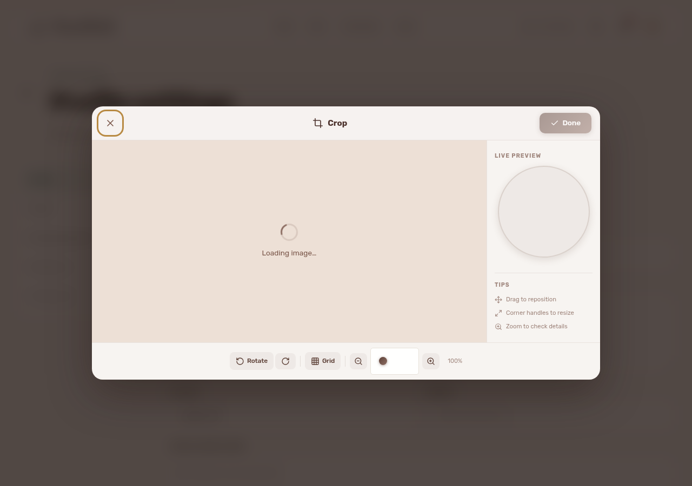
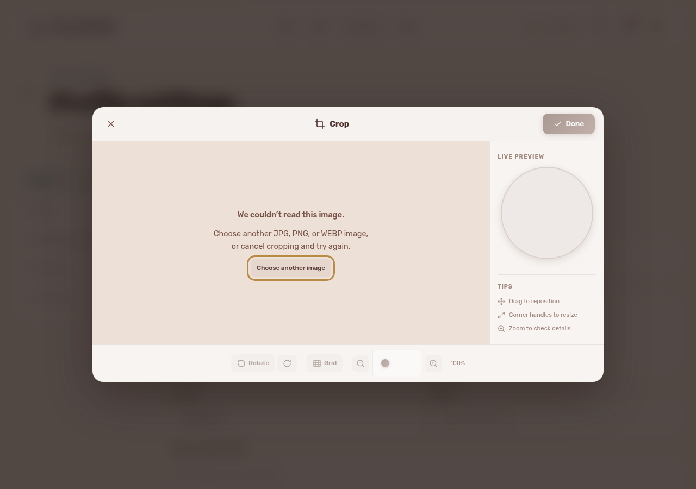
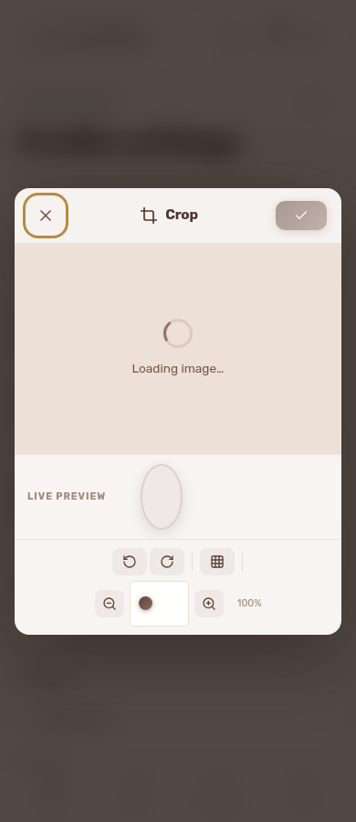
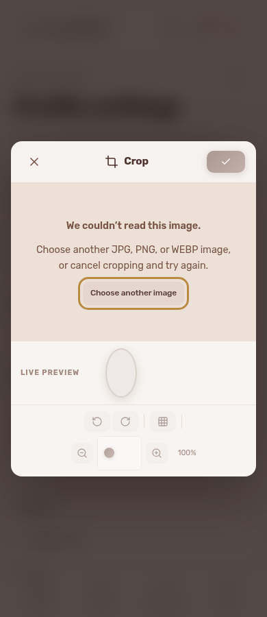
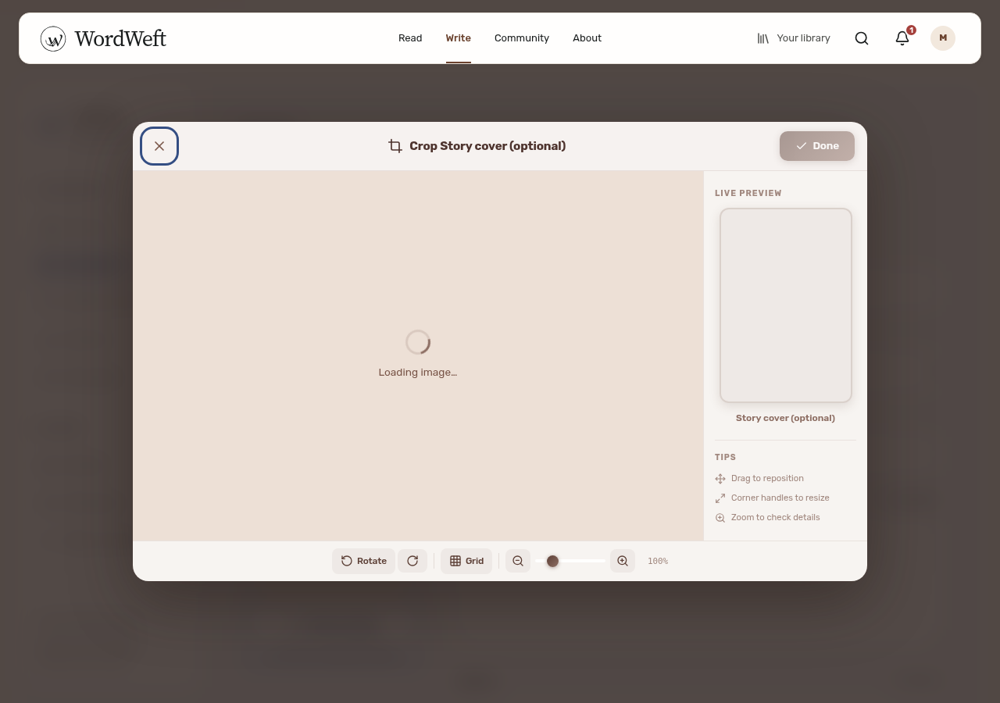
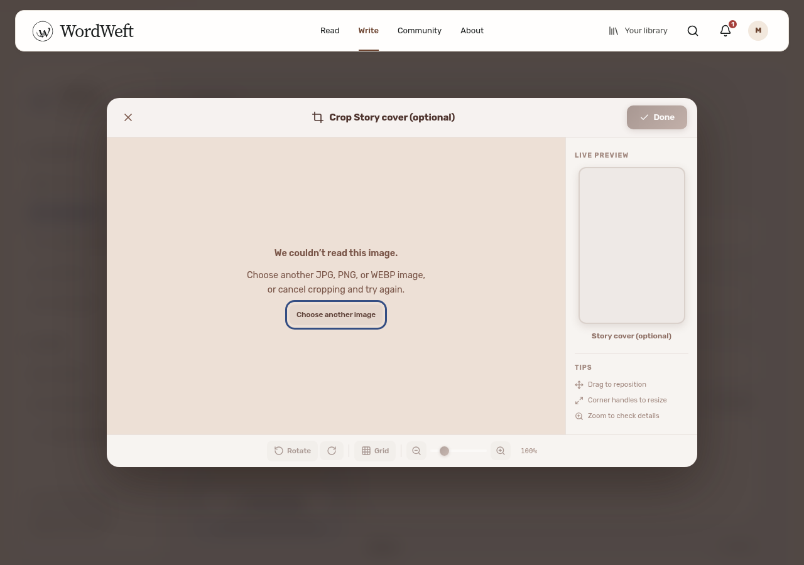
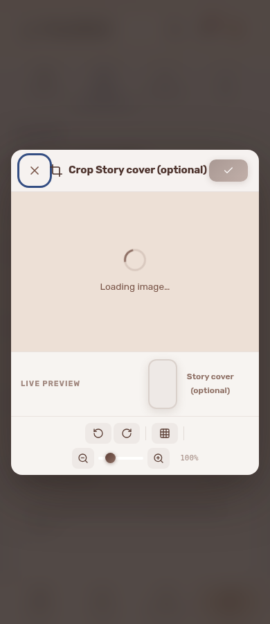
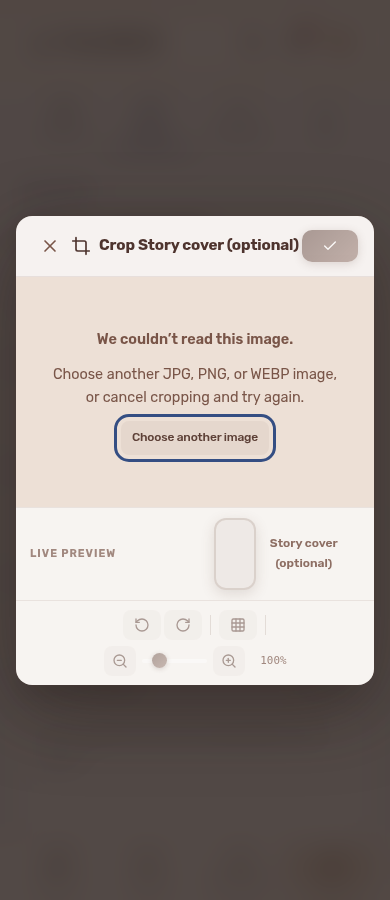

# Unreadable crop images (#193)

Before: a file with an accepted image MIME type but unreadable bytes left the crop dialog on Loading image… indefinitely. After: the loader’s error event stops loading and announces a readable failure. Choose another image opens the existing picker with a reset input; Cancel/Escape remains available. Crop controls stay disabled until a usable image has loaded. Object URLs are revoked when the dialog closes or a file is replaced.

| Entry | Before: permanent loading | After: actionable decode error |
| --- | --- | --- |
| Avatar desktop 1280 |  |  |
| Avatar mobile 390 |  |  |
| Story cover desktop 1280 |  |  |
| Story cover mobile 390 |  |  |

Install project dependencies and Playwright Chromium (`npx playwright install chromium`), start Vite and a disposable backend with local fixtures, then run:

```sh
E2E_BASE_URL=http://127.0.0.1:3024 node .github/audit-fixes/193/regression.mjs
```

Optional `E2E_EMAIL` / `E2E_PASSWORD` select another disposable writer; defaults are `writer@example.test` / `WordWeftLocal123!`. `CHROMIUM_PATH` overrides the browser. Otherwise an existing system Chromium or managed Playwright Chromium is used. No private token file is needed.

`AUDIT_BEFORE=1` against unchanged production reproduces the spinner and captures the matching baseline. Normal mode failed on production because no accessible error appeared (`red.log`). The fixed regression tests actual avatar and story-cover routes at desktop and mobile sizes: corrupt PNG, JPG and WEBP, finite accessible error with no spinner, disabled Done, Tab retained in the dialog, same-file reselect, Escape/cancel resetting the input, valid-image retry enabling Done, object URL cleanup, and zero upload/auth requests for invalid files. It never saves profile or story changes and never uploads an image.

The shared editor crop surface also receives the accessible error and existing Cancel recovery; the direct picker action is provided by ImageUpload for avatar/artwork entry points. Native iPhone/Safari and physical screen-reader testing were not performed. Full project tests, TypeScript, and frontend/SSR/SEO build logs are included.
