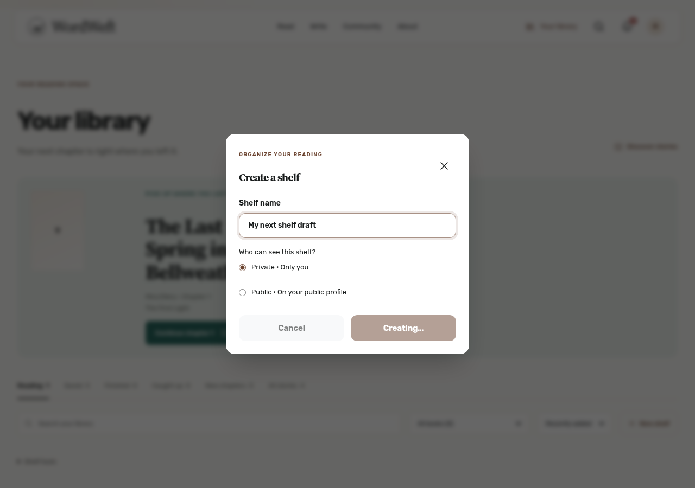
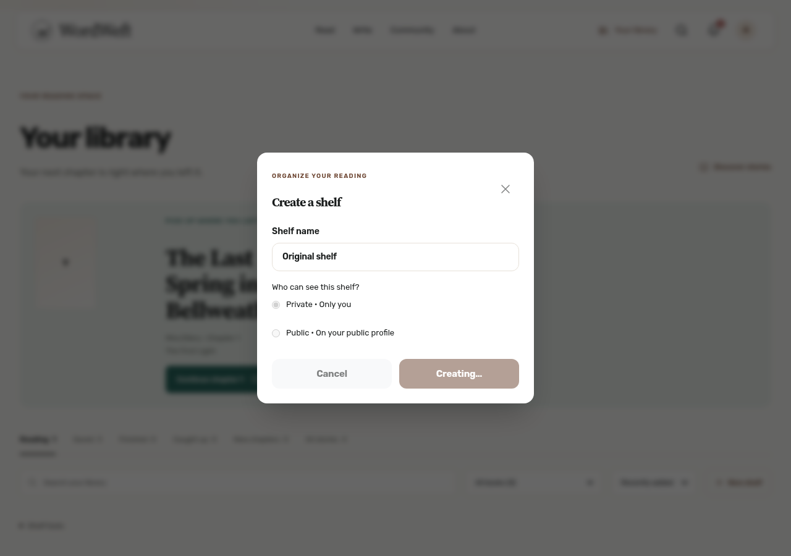
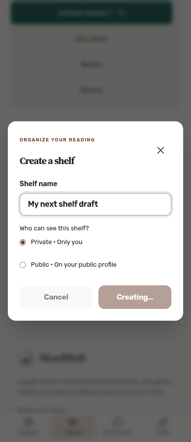
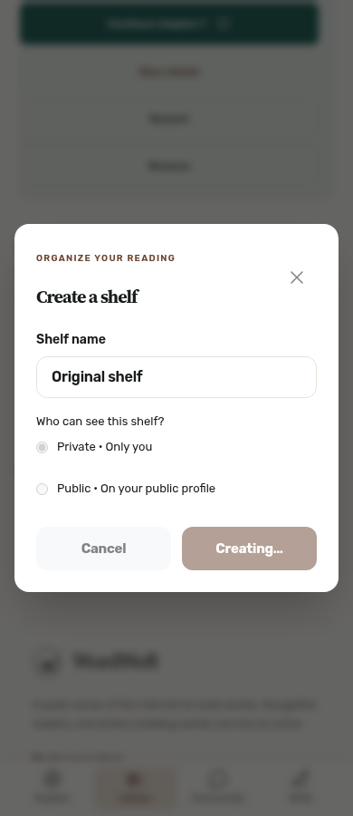

# Shelf creation pending lifecycle (#194)

A pending creation uses one consistent dismissal policy: Close, Cancel, Escape and the backdrop retain the dialog until the request settles. Name and privacy controls are disabled while submitting, so the successful response cannot erase a newer editable draft. Failure retains the submitted name and privacy for retry. Success resets the next form and returns focus to New shelf.

Regression: `E2E_BASE_URL=http://127.0.0.1:3026 node .github/audit-fixes/194/regression.mjs` against the local production-source Vite server on 3026 and disposable backend on 8080. The script signs in through the local fixture login API. Optional `E2E_EMAIL` and `E2E_PASSWORD` override the documented disposable reader account; no private token file is required. Set optional `CHROMIUM_PATH` to use a system Chromium; otherwise Playwright uses its installed browser. Browser: Chromium, desktop 1280px and mobile/touch 390px. Native Safari was not tested.

Before the fix the regression failed with `false !== true`: Close was enabled while Creating. After the fix it verifies disabled controls, Escape/backdrop retention, one request, delayed failure draft preservation, delayed real-backend success, public shelf visibility, clean next form, and focus restoration. Created success fixtures are deleted after verification.

Screenshots: desktop/mobile retry and successful creation. No production data or production writes.

## Before → after

Before: the active request could be dismissed with Close, then its response closed the reopened form and erased `My next shelf draft`. After: Close follows Cancel, Escape and backdrop, and every submitted field stays disabled until the request settles. Failure preserves the draft for retry; success creates the intended shelf, resets the next form and returns focus.

| Width | Before: reopened unsent draft during earlier request | After: original pending form retained |
| --- | --- | --- |
| Desktop 1280 |  |  |
| Mobile 390 |  |  |

`before-observations.json` records the old response closing the reopened dialog and the empty recovered draft. `baseline.mjs` reproduces it against unchanged production Library code (set `E2E_BASE_URL` to that local server); it intercepts only the creation response, so no shelf is written. The fixed regression covers actual backend success and deletes its synthetic shelves.
