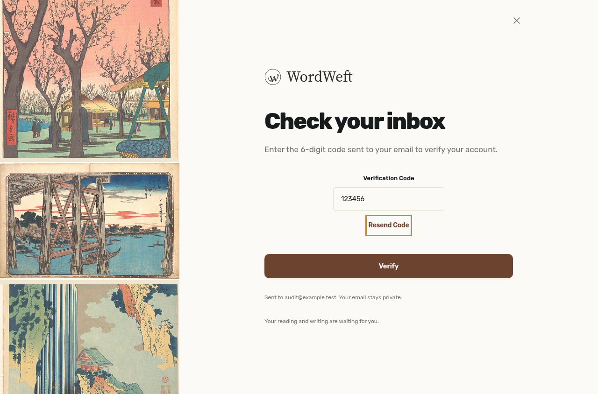
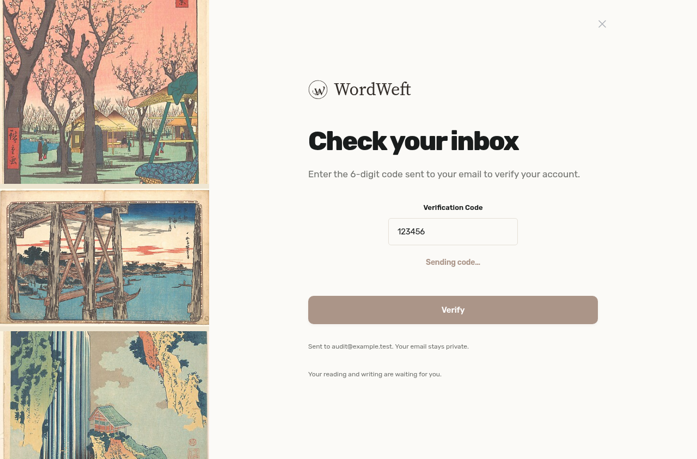
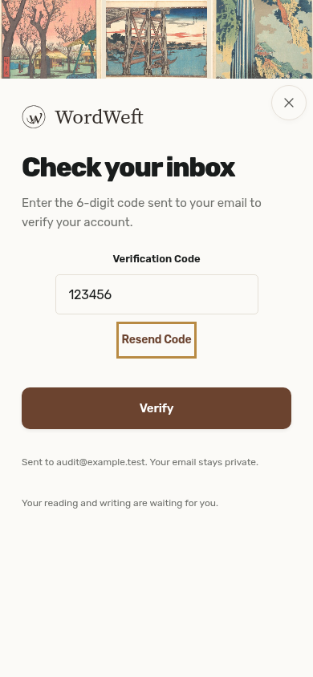
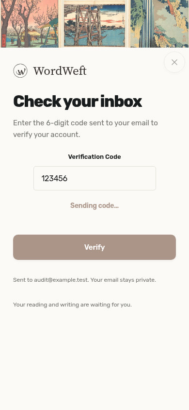

# OTP resend pending request regression

After installing dependencies, run Vite on port 3024, then `node .github/audit-fixes/206/regression.mjs`.

`E2E_BASE_URL` overrides the frontend address; `CHROMIUM_PATH` overrides the Chromium executable.

Before the fix the regression failed because Resend Code remained enabled during the delayed request. After the fix both 1280px desktop and 390px mobile Chromium pass: one request while pending, disabled sending feedback, invalid and expired OTP recovery, failed delivery returns to usable retry, and successful retry starts the cooldown. Screenshots show the pending state. The test intercepts authentication and resend responses locally; no email is delivered. Native Safari and physical screen-reader testing are outside this verification.

## Before → after

Before: Resend Code stayed enabled while delivery was pending, so Enter, Space and repeated activation created concurrent requests. After: one pending request shows Sending…, disables further activation, and starts its cooldown only after acceptance. Failed delivery announces the error and restores a usable retry.

| Width | Before: enabled during delivery | After: one disabled Sending action |
| --- | --- | --- |
| Desktop 1280 |  |  |
| Mobile 390 |  |  |

The before/after observation JSON records request counts because a screenshot cannot prove concurrency. `AUDIT_BEFORE=1` reproduces the enabled/concurrent state against unchanged production Auth code; normal mode verifies the fixed policy. All auth responses are intercepted locally; no email is sent.
