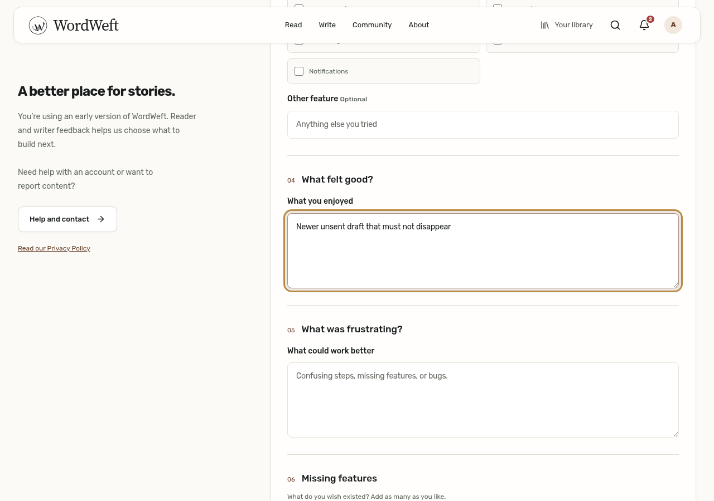
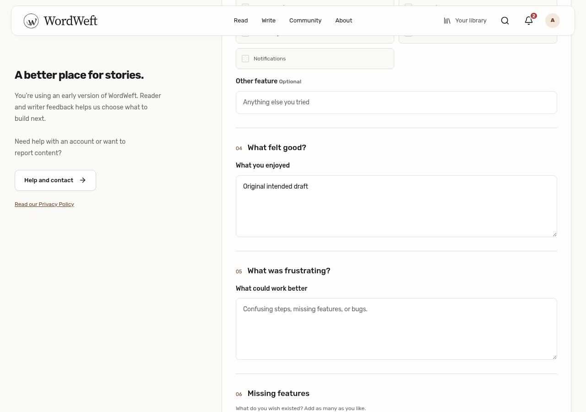
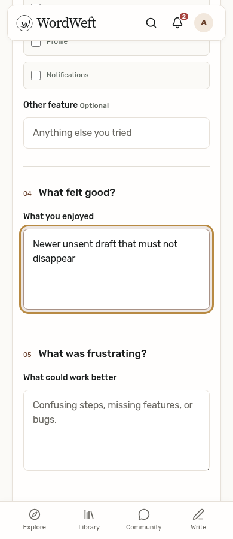
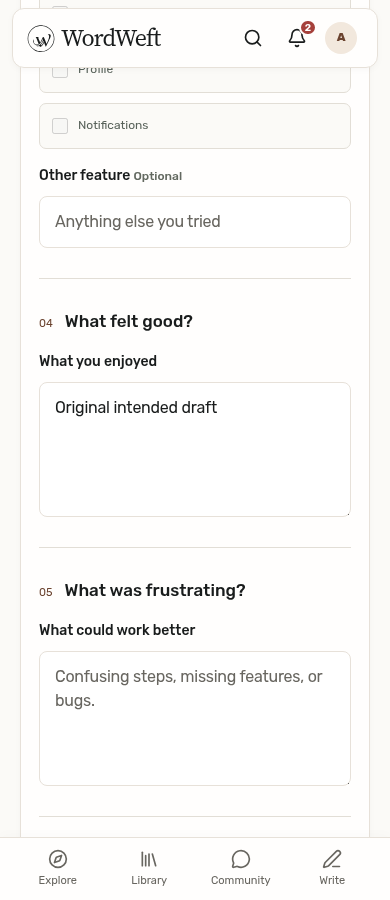
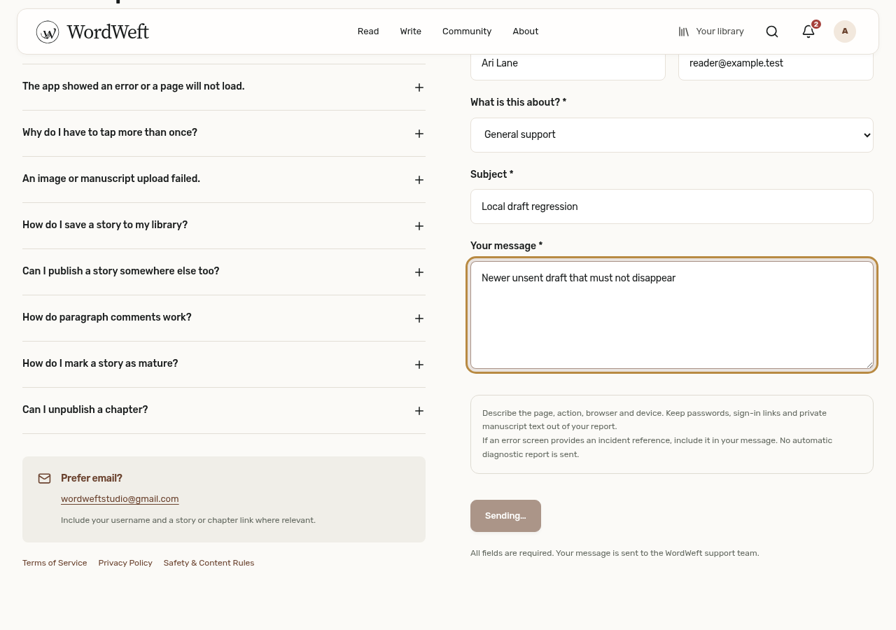
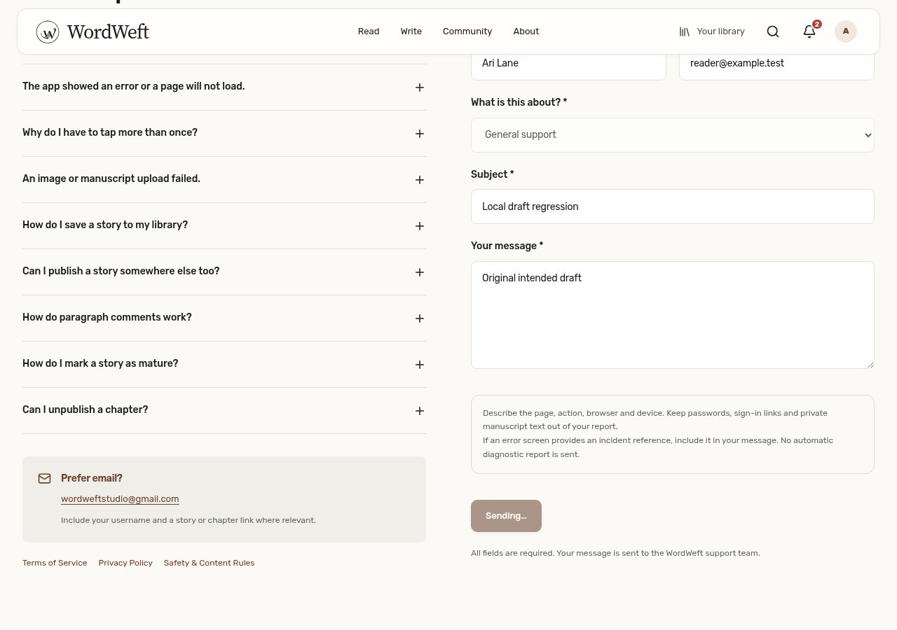
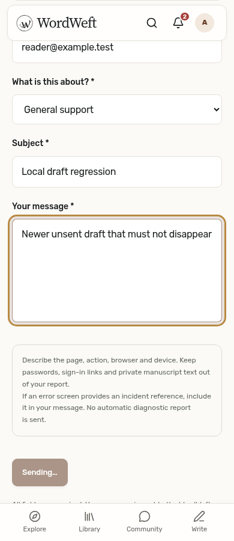
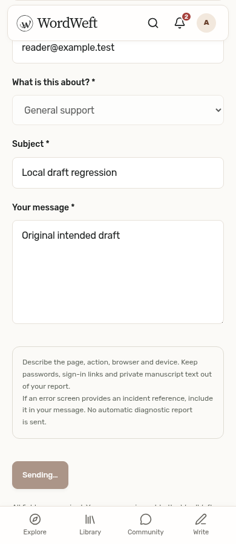

# Feedback and Contact pending drafts (#207)

Before: both forms accepted new edits while an older request was pending. Its success cleared the recoverable history and hid the newer unsent response. After: the submitted controls are disabled together until settlement, with Submitting…/Sending… and `aria-busy`. A synchronous guard suppresses a second submit event. Failure restores the unchanged draft for retry; success clears only that mounted form. A response after navigation cannot clear a newly reopened draft.

| Surface | Before: newer unsent edit accepted | After: original draft locked while sending |
| --- | --- | --- |
| Feedback desktop 1280 |  |  |
| Feedback mobile 390 |  |  |
| Contact desktop 1280 |  |  |
| Contact mobile 390 |  |  |

## Reproduce

Install project dependencies and Playwright Chromium (`npx playwright install chromium`), run Vite with its API proxy pointing at the disposable backend on 8080, and run:

```sh
E2E_BASE_URL=http://127.0.0.1:3024 node .github/audit-fixes/207/regression.mjs
```

The local login fixture defaults to `reader@example.test` / `WordWeftLocal123!`; optional `E2E_EMAIL` and `E2E_PASSWORD` select another disposable reader. `CHROMIUM_PATH` overrides the browser; otherwise an existing system Chromium or the managed Playwright browser is used. No private token file is required. Support POST responses are intercepted locally, so no feedback or support message is delivered.

Set `AUDIT_BEFORE=1` against an unchanged production checkout to capture the baseline screenshots and JSON. Normal mode fails against production (`red.log`, pending text remains enabled), and `lifecycle-red.log` records the later navigation regression before the mounted guard. `green.log` and `after-observations.json` verify both forms at desktop and mobile sizes: every submitted control disabled (including feedback rating/options/tags), one request despite duplicate submit, failure/retry, browser Back recovery, clean success, Send another message, and a late response preserving a reopened newer draft after reload. `before-observations.json` records the accepted newer edit and subsequent empty draft.

Full unit suite: 320 passed; TypeScript and frontend/SSR/SEO build completed (logs included). Chromium with a touch/mobile viewport was tested; native iPhone/Safari was not.
