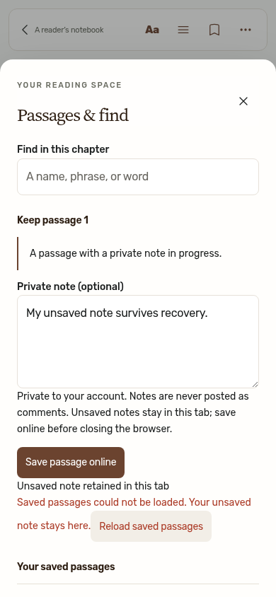
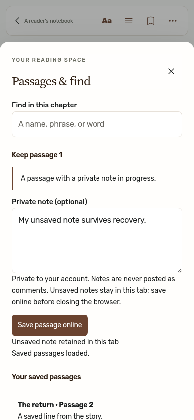
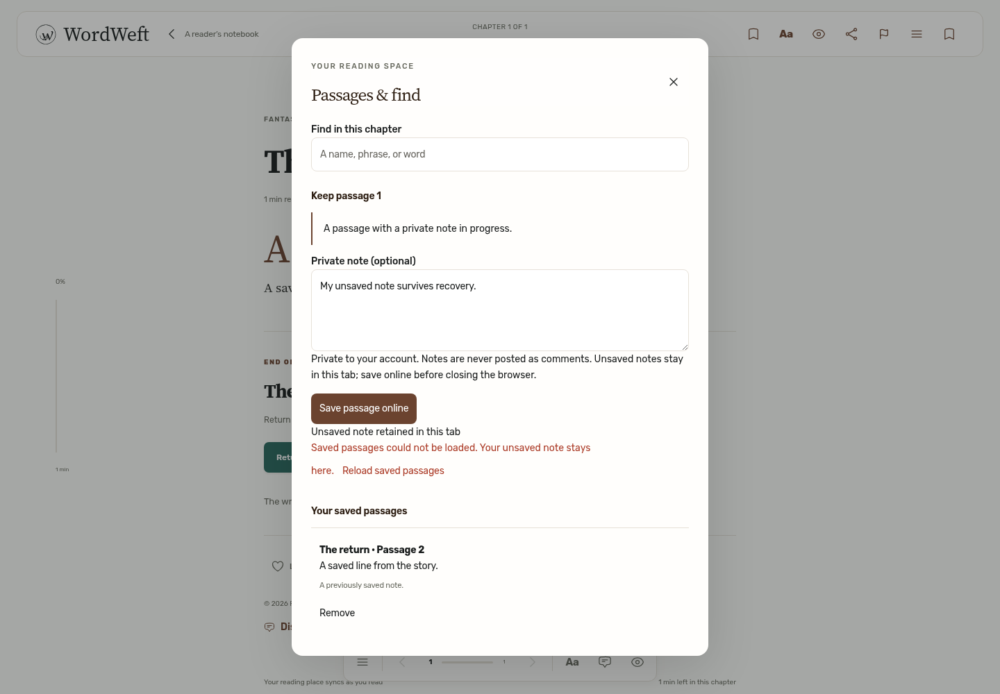
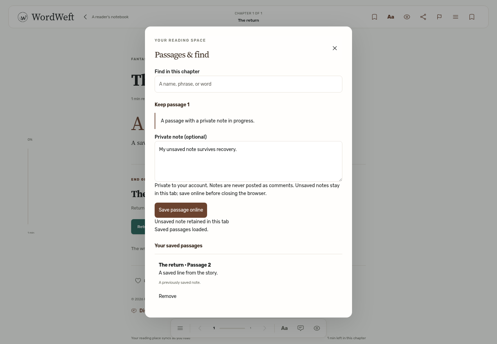

# #210 — saved-passage list recovery

Before, a successful saved-passage retry rendered the returned rows but left the old failure alert and Reload saved passages button visible. After, the list error clears and a polite status announces “Saved passages loaded.” Load failures and save/delete failures have separate state, so a healthy list response cannot erase an unrelated mutation error. Drafts and cached rows remain present while the list reloads.

| Matching recovered state | Before | After |
| --- | --- | --- |
| Mobile, 390×844 |  |  |
| Desktop, 1440×1000 |  |  |

Both states follow the same GET 503 → GET 200 sequence. `before-*.json` and `after-*.json` record one saved row and the same unsaved draft; the stale load-alert count changes from 1 to 0. Lifecycle JSON records subsequent reopen, later failure, failed save, successful reload, failed delete, successful reopen, and successful save requests.

Regression: `E2E_BASE_URL=http://127.0.0.1:3000 npx playwright test e2e/audit-210-passage-recovery.spec.ts`. Optional `AUDIT_EVIDENCE_DIR` and `AUDIT_PHASE=before` capture proof. Production baseline `4055dbf` fails the stale-alert assertion at both widths. The fixed browser journeys also check recovery announcements, no retry button after success, draft retention, later failures, reopened healthy panels, visible cached rows during a held reload, and save/delete error isolation. Full unit tests, typecheck and production/SSR builds pass.

Scope: the actual reader UI and API client run locally with controlled, synthetic API responses to produce deterministic failure/recovery sequences. This is frontend/request proof, not backend persistence proof. Mobile is Chromium viewport emulation; physical iPhone/native Safari accessibility remains unverified. No merge or deployment.
